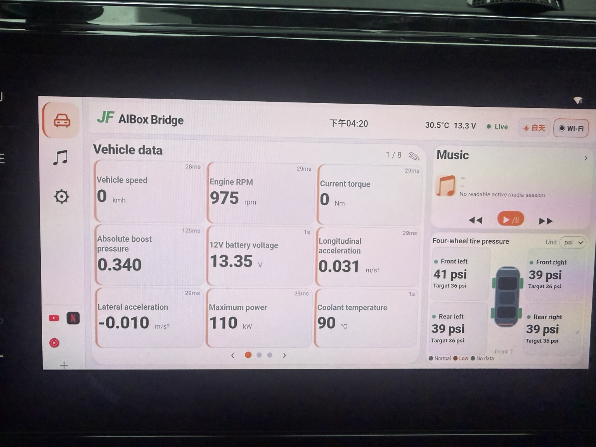
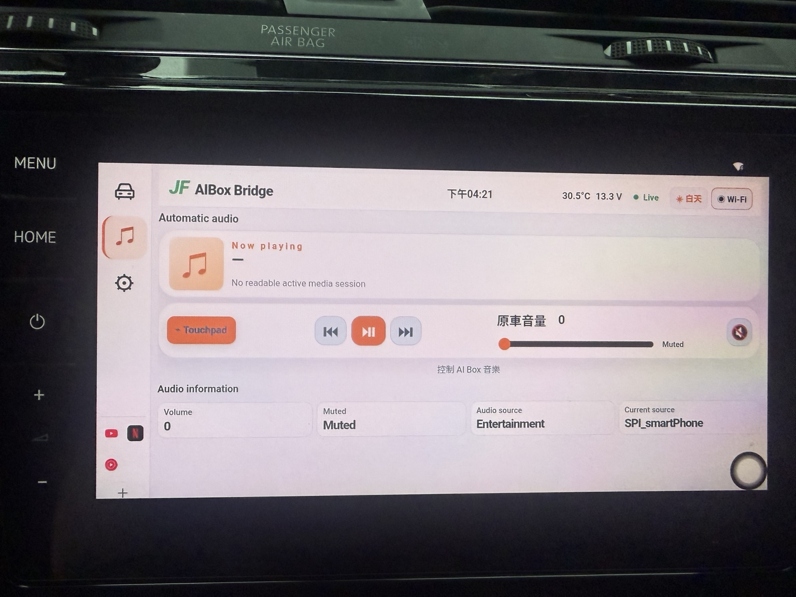

# JF AIBox Bridge

**Android Vehicle Dashboard for compatible VW Group MIB2.5 head units**

JF AIBox Bridge is a community-developed Android application that uses EXLAP to display supported vehicle information on an Android phone or Android AI Box. It offers an alternative interface while the community continues developing native MIB interface modifications.

**Current target:** Compatible VW Group **MIB2.5** systems, including tested MU1101-based configurations. Other head units, firmware versions and vehicles are not guaranteed to work.

## Screenshots — Real Vehicle Demonstration

### Vehicle Dashboard & Tire Pressure Monitoring

Live EXLAP data shown on the vehicle display: speed, engine RPM, torque, boost pressure, battery voltage, acceleration, coolant temperature and four-wheel tire pressure (where supported). Version 1.0.3 also supports individual tire temperatures when exposed by the vehicle.

### Media Control

Media information, playback buttons, source status and volume controls. Available controls depend on the connected media session and device.

## Download

**Latest release: [JF AIBox Bridge v1.0.2 — Download APK](https://github.com/jjff2/JF-AI_Box-Bridge/releases/tag/v1.0.2)**

Version 1.0.2 includes the V8.3 dashboard, adjustable text scaling and collapsible music/TPMS panel. The maintainer reports successful testing on their device. [Older releases](https://github.com/jjff2/JF-AI_Box-Bridge/releases) remain available.

On the release page, expand **Assets** and download the APK file. Install it on a compatible Android device. Only install software from sources you trust.

## What's New in v1.0.3

- Four-wheel tire temperature readings, independent °C / °F selection, and corrected vehicle-information display.
- **TPMS firmware prerequisite:** In the maintainer's configuration, compatible TPMS module firmware had to be flashed before the head unit could expose tire temperature over EXLAP. The APK itself does not flash the module. See the [Drive2 community reference](https://www.drive2.ru/l/748710244984567276/) and [release notes](RELEASE_NOTES.md) for details. Firmware compatibility and the raw −60 offset must be verified on the vehicle.

## What's New in v1.0.2

- Consolidated header and navigation layout for vehicle, media and settings views.
- Collapsible music and tire-pressure panels, allowing vehicle readings more space.
- Adjustable typography with live vehicle-data preview and clearer expand/collapse controls.
- Responsive layouts for Android AI Box, desktop browsers, iPhone and iPad; device support must be verified.

## Main Features

- **Vehicle dashboard:** Display supported real-time EXLAP vehicle data, including speed, RPM, battery voltage, temperatures and other available signals.
- **Tire pressure:** Show four-wheel TPMS readings and status when provided by the vehicle.
- **Media dashboard:** View available track/session information and use supported playback and volume controls.
- **Safari Touchpad:** Access a local browser-based remote control from an iPhone or iPad, with supported navigation, shortcuts and controls.
- **Screen mirroring:** Optional Android screen capture for compatible local browser views; Android permission approval is required.
- **Connection tools:** Wi-Fi access information, QR codes and diagnostics to help check connectivity.
- **Customizable interface:** Dashboard pages and appearance options, depending on the app build.

Some functions require Android permissions and may not work with every vehicle, firmware, Android device or media app.

## Requirements

- An Android phone or Android AI Box capable of running the application.
- A compatible VW Group MIB2.5 infotainment system with accessible EXLAP services.
- A local Wi-Fi connection allowing the Android device to communicate with the head unit.
- Additional Android permissions for optional Touchpad, media metadata and screen capture features.

**Important:** Connecting to an ordinary internet hotspot alone does not provide access to vehicle EXLAP data.

## Quick Start

1. Download the APK from the [v1.0.2 release](https://github.com/jjff2/JF-AI_Box-Bridge/releases/tag/v1.0.2).
2. Install and open JF AIBox Bridge on your Android phone or AI Box.
3. Connect the Android device to the compatible MIB2.5 Wi-Fi network.
4. Open the app's connection settings and use the available head unit IP detection or manual configuration.
5. Check the EXLAP connection status and open the vehicle dashboard.
6. Enable optional Android permissions only for the features you intend to use.

For more information, see [Installation](INSTALLATION.md), [EXLAP Setup](EXLAP_SETUP.md) and [Troubleshooting](TROUBLESHOOTING.md).

## iPhone / iPad Safari Remote Touchpad

The app can provide a browser-based Touchpad on a trusted local network. Connect your iPhone/iPad and Android device so they can reach each other, then use the in-app QR code or local address to open the Touchpad in Safari.

Remote gestures may require Android **Accessibility Service** permission. Screen viewing requires **MediaProjection / screen capture** approval. Availability depends on device and Android version.

**Security:** Keep remote-control services on a trusted local network. Do not forward local control ports to the public internet.

## Permissions and Safety

| Function | Access or permission |
| --- | --- |
| Vehicle information | Compatible Wi-Fi and EXLAP connection |
| Media metadata | Notification access, where required |
| Remote gestures | Android Accessibility Service |
| Screen viewing | Android screen capture / MediaProjection |

- Do not interact with the application while driving. Configure and test it while safely parked.
- Remote control and screen capture may expose sensitive information on the Android device.
- Local HTTP control traffic may not be encrypted; use only trusted networks.
- This project is not a safety-critical instrument and does not replace the vehicle's original displays or warnings.

Read [Permissions and Safety](PERMISSIONS_AND_SAFETY.md) before enabling optional services.

## Community Appreciation

A sincere thank-you to everyone researching and developing **native MIB interface modifications** and generously sharing technical knowledge, tools and public resources.

Those contributions have helped the wider community understand these systems and made independent experiments like this possible. JF AIBox Bridge is not intended to compete with or replace native modifications; it is simply another option to explore while that work continues.

Thank you to everyone who shares discoveries, tests ideas and helps other enthusiasts learn.

## EXLAP Research and Attribution

This project draws on publicly shared EXLAP research, including the [EXLAP MIB2 Object Atlas](https://github.com/ijord/EXLAP-mib2-atlas), whose referenced material is identified under **Creative Commons Attribution 4.0 International (CC BY 4.0)**.

Please review [EXLAP Attribution](EXLAP_ATTRIBUTION.md) for source acknowledgements and details. Attribution to external research does not imply endorsement by its authors or determine the license of this entire application.

## Documentation

- [Installation Guide](INSTALLATION.md)
- [EXLAP Setup](EXLAP_SETUP.md)
- [EXLAP Attribution](EXLAP_ATTRIBUTION.md)
- [Permissions and Safety](PERMISSIONS_AND_SAFETY.md)
- [Troubleshooting](TROUBLESHOOTING.md)
- [Release Notes](RELEASE_NOTES.md)
- [GitHub Publishing Guide](GITHUB_PUBLISHING.md)

## Source Code and Contributions

The source code is publicly available for inspection and community feedback. **Public source availability alone does not establish an open-source license.** Until an explicit license is added for the original application code, do not assume unrestricted redistribution or relicensing rights.

Issues, compatibility reports and suggestions are welcome. When reporting a problem, include your Android device, Android version, MIB2.5 model/firmware, app version and a description of the issue. Remove credentials and personal or vehicle-identifying information from logs before sharing them.

## Disclaimer

JF AIBox Bridge is an independent community project and is **not affiliated with, sponsored by or endorsed by** Volkswagen, Audi, Škoda, SEAT or any vehicle manufacturer. Compatibility and functionality vary by configuration. Use at your own risk.

---

**Developed and shared by JF VAG — Taiwan**

*Thanks to everyone contributing to the MIB development community.*
